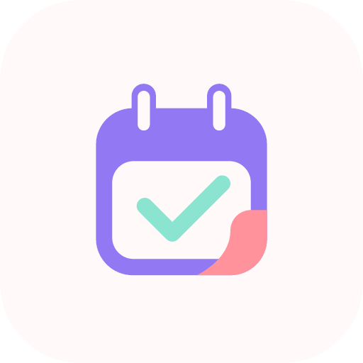

<p align="center">
  
</p>

<h1 align="center">Attendly</h1>

<p align="center">
  <strong>Intelligent, offline-first college attendance companion designed with Apple HIG restraint.</strong>
</p>

<p align="center">
  
  
  
</p>

---

## Overview

Attendly gives university students effortless, mathematical control over their course attendance. Built with a focus on speed, privacy, and Apple Human Interface Guidelines aesthetic, Attendly lets you log sessions in seconds, track Lecture and Lab components independently, and know precisely how many classes you can safely miss—or need to attend for recovery.

100% offline-first. Zero accounts, zero ads, zero trackers. Your academic standing stays strictly on your personal device.

---

## Key Features

- **⚡ Fast Quick Log:** Floating navigation dock with one-tap session logging for Present, Absent, or cancellation with instant undo.
- **🎯 Safe Absence & Recovery Engine:**
  - **Safe Absences:** Know exactly how many classes you can skip while staying safely above your target threshold.
  - **Recovery Targets:** Exact count of consecutive attended classes required to regain good standing.
- **🧪 What-If Attendance Simulator:** Sandboxed projection workspace to model future attendance outcomes without modifying real SQLite records.
- **📚 Multi-Component Tracking:** Full support for independent Lecture and Lab sessions per subject with equal-weight (`raw_combined`) or 50/50 (`component_average`) policies.
- **📈 Trend Analytics & Insights:** Chronological attendance sparklines, component balance charts, and actionable performance insights.
- **🔒 Local Backup & Restore:** Atomic JSON export/import with schema validation and one-tap sample data seeding.
- **📱 Android Home Screen Widgets:** Live attendance progress and quick-log shortcuts directly on your Android home screen.
- **🌗 Apple HIG Aesthetics:** Pure dark and light modes, crisp hairline borders, tabular numerals, fluid motion, and zero muddy translucent overlays.

---

## Tech Stack

| Layer | Technology |
| :--- | :--- |
| **Framework** | Flutter (Dart 3) |
| **State Management** | Flutter Riverpod |
| **Local Database** | Drift (SQLite) with transactional migrations |
| **Routing** | GoRouter (declarative deep linking) |
| **Preferences** | SharedPreferences |
| **Typography** | Plus Jakarta Sans with tabular figures |
| **Native Integration** | Kotlin RemoteViews & Android AppWidgetProvider |

---

## Getting Started

### Prerequisites
- [Flutter SDK](https://docs.flutter.dev/get-started/install) (`^3.24.0` or later)
- Android Studio / VS Code with Flutter extension
- Android SDK (API 34+ recommended)

### Installation

1. **Clone the repository:**
   ```bash
   git clone https://github.com/ayushpatil0810/attendly.git
   cd attendly
   ```

2. **Install dependencies:**
   ```bash
   flutter pub get
   ```

3. **Run code generation (for Drift database):**
   ```bash
   dart run build_runner build --delete-conflicting-outputs
   ```

4. **Launch the application:**
   ```bash
   flutter run
   ```

---

## Verification & Testing

Attendly maintains a comprehensive test suite covering domain calculators, SQLite repositories, transactional backups, and UI widgets:

```bash
# Run static analyzer
dart analyze

# Execute all unit and widget tests
flutter test
```

---

## Architecture

```
lib/
├── app/               # App entrypoint, GoRouter setup & theme wiring
├── core/              # Drift SQLite database, Backup service, Theme tokens & Shared UI
└── features/
    ├── attendance/    # Session logging, history calendar & calculation services
    ├── dashboard/     # Home summary, attendance rings & actionable cards
    ├── insights/      # Component comparisons, trend charts & observations
    ├── onboarding/    # First-launch flow & initial semester setup
    ├── semesters/     # Semester lifecycle, switcher & QR share
    ├── settings/      # Academic targets, appearance, reminder & backup
    ├── simulator/     # What-If projection engine & hypothetical sandbox
    └── subjects/      # Course management, lecture/lab toggles & expanded stats
```

---

## Author & Developer

**Ayush Patil**
- 🌐 Website: [ayushpatil.in](https://ayushpatil.in)
- 🐙 GitHub: [@ayushpatil0810](https://github.com/ayushpatil0810)
- 📦 Repository: [ayushpatil0810/attendly](https://github.com/ayushpatil0810/attendly)

---

## License & Open Source

Attendly is an open-source project licensed under the [MIT License](LICENSE). Contributions, issues, and feature suggestions are warmly welcomed!
